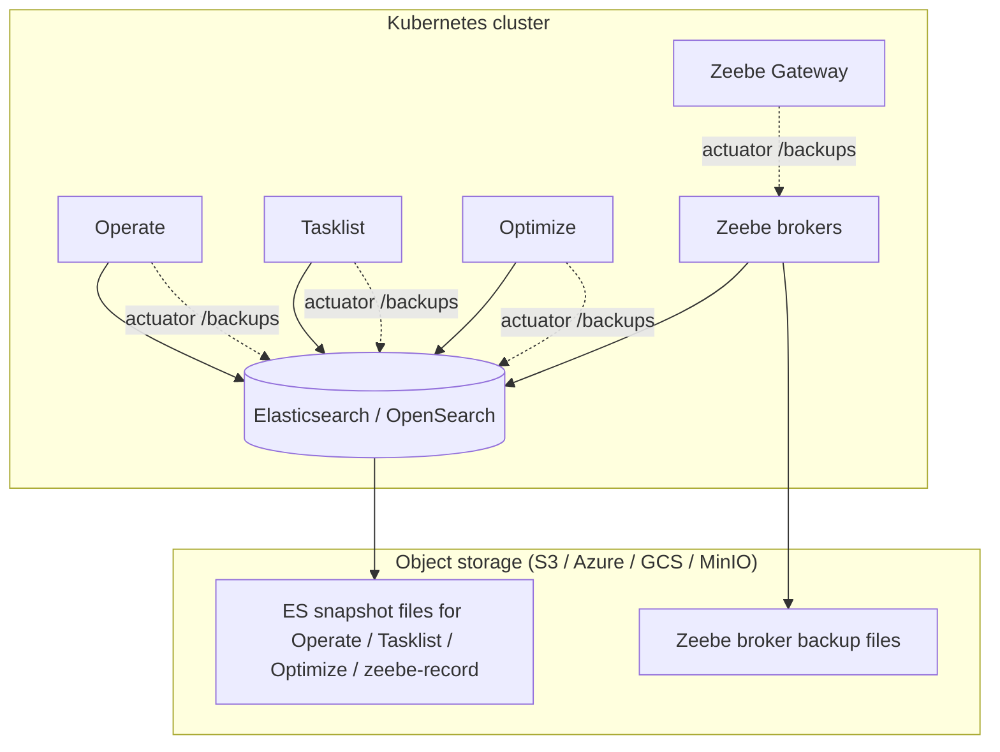

# Camunda 8.7 backup & restore — reference guide (with Blueberry)

This document is a **beginner-oriented reference** for using the **Blueberry** app in this repository together with a **Camunda 8.7 Self-Managed** cluster. It assumes you are new to Camunda backup concepts.

For the official procedure, always cross-check:

- [Camunda 8.7 — Create a backup](https://docs.camunda.io/docs/8.7/self-managed/operational-guides/backup-restore/backup/)
- [Camunda 8.7 — Restore a backup](https://docs.camunda.io/docs/8.7/self-managed/operational-guides/backup-restore/restore/)
- [Backup / restore overview (ES vs RDBMS)](https://docs.camunda.io/docs/self-managed/operational-guides/backup-restore/backup-and-restore/)

---

## Table of contents

1. [What is Camunda 8 Self-Managed?](#1-what-is-camunda-8-self-managed)
2. [Important: two backup models in Camunda 8.7](#2-important-two-backup-models-in-camunda-87)
3. [What gets backed up and where](#3-what-gets-backed-up-and-where)
4. [What is Blueberry?](#4-what-is-blueberry)
5. [Concepts you must understand](#5-concepts-you-must-understand)
6. [Before you start — cluster prerequisites](#6-before-you-start--cluster-prerequisites)
7. [Configure Blueberry to talk to your cluster](#7-configure-blueberry-to-talk-to-your-cluster)
8. [Run Blueberry locally or in Kubernetes](#8-run-blueberry-locally-or-in-kubernetes)
9. [Using the Blueberry UI (typical workflow)](#9-using-the-blueberry-ui-typical-workflow)
10. [What Blueberry does during an automated backup](#10-what-blueberry-does-during-an-automated-backup)
11. [Restore on 8.7 (mostly outside Blueberry today)](#11-restore-on-87-mostly-outside-blueberry-today)
12. [8.7-specific notes and gaps in this repo](#12-87-specific-notes-and-gaps-in-this-repo)
13. [Troubleshooting](#13-troubleshooting)
14. [Quick checklist](#14-quick-checklist)
15. [Further reading in this repo](#15-further-reading-in-this-repo)

---

## 1. What is Camunda 8 Self-Managed?

**Camunda 8** is a process automation platform. In **Self-Managed** mode, you run the software on **your** infrastructure (often Kubernetes + Helm), instead of Camunda’s cloud (SaaS).

Typical components in a cluster:

| Component | Role (simple) |
|-----------|----------------|
| **Zeebe** | The **workflow engine** — runs process instances, jobs, timers. This is the **source of truth** for running workflows. |
| **Operate** | Web UI to **inspect** process instances, incidents, deployments. |
| **Tasklist** | Web UI for **human tasks** (user tasks). |
| **Optimize** | Analytics / reporting on process performance. |
| **Elasticsearch or OpenSearch** | **Secondary storage** — search indexes used by Operate, Tasklist, Optimize (and Zeebe **record** export). |
| **Zeebe Gateway** | Client entry point to Zeebe; also exposes **management** APIs used for backup. |

Blueberry does **not** replace Camunda; it **orchestrates backup APIs** and helps **check** that backup-related configuration exists.

---

## 2. Important: two backup models in Camunda 8.7

Camunda 8.7 documentation describes **two** backup approaches:

| Model | Secondary storage | Shared backup ID? | Blueberry in this repo |
|-------|-------------------|-------------------|-------------------------|
| **Elasticsearch / OpenSearch** | ES/OS indexes for web apps + Zeebe record export | **Yes** — one integer ID for all components | **Supported** |
| **RDBMS** (relational DB) | Database for web apps; different Zeebe backup story | **No** — decoupled backups | **Not supported** |

**If your 8.7 Helm values use RDBMS for Operate/Tasklist**, stop here and follow the RDBMS sections in the [official overview](https://docs.camunda.io/docs/self-managed/operational-guides/backup-restore/backup-and-restore/). This guide and Blueberry target the **Elasticsearch/OpenSearch** path.

---

## 3. What gets backed up and where

Think of backup as **two layers**:

### Layer A — Web applications (Operate, Tasklist, Optimize)

- Each app triggers **Elasticsearch/OpenSearch snapshots** of **its** indexes.
- Snapshots are stored in a **snapshot repository** registered in ES/OS (backed by S3, Azure Blob, GCS, MinIO, etc.).
- Each app is configured with a **repository name** (environment variable).

### Layer B — Zeebe engine + exported records

1. **Zeebe broker data** (partitions on disk) → backed up to **object storage** (S3/Azure/GCS) via Zeebe’s backup store settings.
2. **Zeebe record indices** in ES/OS (`zeebe-record*`) → separate **ES/OS snapshot** while export is paused (see official 8.7 order).



---

## 4. What is Blueberry?

**Blueberry** (this project) is a **Spring Boot + React** application that:

- Shows a **dashboard** and backup status.
- **Checks configuration** (repositories, container settings) and can **create** missing ES snapshot repositories (Configuration page).
- **Starts a coordinated backup** using the same REST/actuator calls described in Camunda docs.
- **Lists backups** from Operate, Tasklist, Optimize, Zeebe, and Zeebe-record snapshots.

Default URL: **http://localhost:9082** (when run locally).

**Restore** in the UI is **not fully implemented** — plan restores using Camunda’s 8.7 guide and scripts under `doc/restore/`.

---

## 5. Concepts you must understand

### Backup ID

- A **single positive integer** used for **one full backup run** across all components.
- Must be **greater than** any previous backup ID that completed or failed (Zeebe enforces this).
- Common pattern: `export BACKUP_ID=$(date +%s)` (Unix timestamp).

If IDs mismatch between Operate and Zeebe, restore will be **inconsistent**.

### Snapshot repository (Elasticsearch)

- A **named** ES/OS configuration pointing to a bucket/container path.
- Operate, Tasklist, and Optimize each use a **repository name** you set in Helm (`CAMUNDA_*_BACKUP_REPOSITORY_NAME`).
- A **separate** repository is often used for **Zeebe record** snapshots (`camunda_zeebe_records_backup` is a typical name).

### Management API / Actuator

Backup commands are **not** on the public Operate UI port. They are on the **management** port (often **9600** on Operate/Tasklist/Gateway; Optimize may use **8092** or **9600** depending on chart/version — **verify in your cluster**).

Examples:

```bash
curl -X POST "http://localhost:9600/actuator/backups" \
  -H "Content-Type: application/json" \
  -d '{"backupId": 1748937221}'
```

Blueberry calls these URLs for you.

### Soft pause (Zeebe export) — 8.7

Before snapshotting `zeebe-record*` indices, Camunda 8.7 recommends a **soft** export pause so the cluster stays online:

```bash
curl -XPOST "$GATEWAY_MANAGEMENT_API/actuator/exporting/pause?soft=true"
```

See [section 12](#12-87-specific-notes-and-gaps-in-this-repo) for how this repo differs today.

---

## 6. Before you start — cluster prerequisites

Complete these **on the Camunda cluster** before relying on Blueberry (detailed steps live under `doc/storage/`):

1. **Choose object storage** (AWS S3, Azure Blob, GCS, MinIO).
2. **Configure Zeebe** backup store on **every broker** (`ZEEBE_BROKER_DATA_BACKUP_*`).
3. **Register ES/OS snapshot repositories** that point to the same storage (or paths Camunda expects).
4. **Set repository names** on Operate, Tasklist, Optimize (and paths/base paths if required).
5. **Network**: Blueberry must reach:
   - Operate / Tasklist / Optimize **management** URLs
   - Zeebe Gateway **management** URL
   - Elasticsearch/OpenSearch **9200** (or your endpoint)

Storage guides in this repo:

| Storage | Doc |
|---------|-----|
| AWS S3 | [doc/storage/AWS-S3/README.md](storage/AWS-S3/README.md) |
| Azure | [doc/storage/azure/README.md](storage/azure/README.md) |
| GCP | [doc/storage/GCP/README.md](storage/GCP/README.md) |
| MinIO | [doc/storage/minio/README.md](storage/minio/README.md) |

Manual backup steps (without Blueberry): [doc/backup/README.md](backup/README.md) (links may reference older doc versions — prefer 8.7 URLs above).

---

## 7. Configure Blueberry to talk to your cluster

Configuration lives in `src/main/resources/application.yaml` or profile files like `application-devazure.yaml`. Spring Boot allows **environment variable** overrides (relaxed binding).

### Core URLs (in-cluster example)

```yaml
blueberry:
  operateActuatorUrl: http://camunda-operate:9600
  tasklistActuatorUrl: http://camunda-tasklist:9600
  optimizeActuatorUrl: http://camunda-optimize:8092   # confirm in your Helm chart
  zeebeActuatorUrl: http://camunda-zeebe-gateway:9600
  elasticsearchurl: http://camunda-elasticsearch:9200
```

### Repository names (must match Helm env vars)

```yaml
blueberry:
  operateRepository: operaterepository
  tasklistRepository: tasklistrepository
  optimizeRepository: optimizerepository
  zeebeRepository: zeeberecordrepository   # naming varies; align with your ES repos
```

### ES paths when Blueberry **creates** repositories

```yaml
blueberry:
  elasticsearch:
    operateContainerBasePath: operate
    tasklistContainerBasePath: tasklist
    optimizeContainerBasePath: optimize
    zeebeRecordContainerBasePath: zeeberecord
    zeebeRecordRepository: camunda_zeebe_records_backup
```

### Object storage type (for repository creation)

```yaml
blueberry:
  container:
    containerType: s3    # or azure, gcs
    s3:
      bucket: my-backup-bucket
      region: us-east-1
```

### Environment variable examples (Kubernetes)

| YAML property | Example env var |
|---------------|-----------------|
| `blueberry.operateActuatorUrl` | `BLUEBERRY_OPERATEACTUATORURL` |
| `blueberry.elasticsearchurl` | `BLUEBERRY_ELASTICSEARCHURL` |
| `blueberry.container.containerType` | `BLUEBERRY_CONTAINER_CONTAINERTYPE` |
| `blueberry.container.s3.bucket` | `BLUEBERRY_CONTAINER_S3_BUCKET` |

Full parameter table: [doc/blueberry/README.md](blueberry/README.md).

### Local development with `kubectl port-forward`

From [doc/dev/Development.md](dev/Development.md):

```bash
kubectl port-forward svc/camunda-operate 9601:9600 -n camunda &
kubectl port-forward svc/camunda-tasklist 9602:9600 -n camunda &
kubectl port-forward svc/camunda-optimize 9603:9600 -n camunda &
kubectl port-forward svc/camunda-zeebe-gateway 9600:9600 -n camunda &
kubectl port-forward svc/elasticsearch-master 9200:9200 -n camunda &
```

Then use a dev profile pointing to `http://localhost:9601`, etc. (see `application-devazure.yaml`).

### Optional: read settings from `/actuator/env`

For the Configuration page, Camunda components can temporarily expose `env` on the actuator (security sensitive). See [doc/blueberry/README.md](blueberry/README.md). Prefer setting repository names explicitly in Blueberry config for production.

---

## 8. Run Blueberry locally or in Kubernetes

### Build (from repo root)

Requires **Java 21+** and **Maven**.

```bash
CI=false mvn -DskipTests install
```

This builds the React UI and packages `target/blueberry-*-exec.jar`.

### Run locally

```bash
java -jar target/blueberry-1.3.0-exec.jar
# or with a profile:
java -jar target/blueberry-1.3.0-exec.jar --spring.profiles.active=devazure
```

Open **http://localhost:9082**.

Alternative: `mvn spring-boot:run` (see [doc/dev/Development.md](dev/Development.md)).

### Run in Kubernetes

Example manifest: [k8s/blueberry.yaml](../k8s/blueberry.yaml). Official image: `ghcr.io/camunda-community-hub/blueberry:latest`.

**Note:** Ensure the container listens on **9082** (the sample Deployment once used `8080` — align `containerPort` with the app).

Access via port-forward:

```bash
kubectl port-forward svc/blueberry-service 9082:9082 -n camunda
```

---

## 9. Using the Blueberry UI (typical workflow)

1. **Dashboard** — connectivity overview; may show errors if components are unreachable.
2. **Configuration** — run **Check** to validate repositories and Zeebe backup store; **Configure** to create missing ES repositories (when Blueberry has enough storage settings).
3. **Parameters** — verify URLs and repository names Blueberry is using.
4. **Backup** — **Start Backup** (auto next ID) or enter a specific **backup ID**, then monitor until all parts complete.
5. **Restore** — treat as **placeholder**; use official 8.7 restore procedure.

You can also trigger backup via API (for cron/automation) — see Blueberry backup REST endpoints in the Java `BackupRestController` (`/api/backup/...`).

---

## 10. What Blueberry does during an automated backup

Order implemented in `BackupJob` (aligned with Camunda’s **WebApps first, then Zeebe** model):

| Step | Action |
|------|--------|
| 1 | Start backup on **Operate**, **Tasklist**, **Optimize** (`POST .../actuator/backups`) |
| 2 | Wait until each reports **`COMPLETED`** |
| 3 | **Pause** Zeebe exporting (`POST .../actuator/exporting/pause`) |
| 4 | **Snapshot** `zeebe-record*` in ES/OS (`PUT /_snapshot/{repo}/{backupId}`) |
| 5 | **Zeebe broker backup** (`POST .../actuator/backups`) and wait for **`COMPLETED`** |
| 6 | **Resume** Zeebe exporting (`POST .../actuator/exporting/resume`) |

If any step fails, investigate logs in the UI and the target component’s actuator response. After a failed Zeebe backup, use a **new** backup ID for the next attempt.

---

## 11. Restore on 8.7 (mostly outside Blueberry today)

Restore is **destructive** and **version-sensitive**. Read [8.7 restore](https://docs.camunda.io/docs/8.7/self-managed/operational-guides/backup-restore/restore/) fully before acting.

High-level flow:

1. **Match Camunda versions** to snapshot names (e.g. `camunda_operate_<ID>_8.7.2_...`).
2. **Restore ES/OS templates** (8.7 adds steps before snapshot restore — start components briefly on clean datastore).
3. **Restore ES/OS snapshots** for Operate, Tasklist, Optimize, and Zeebe records (same **backup ID**).
4. **Restore Zeebe brokers** with Helm, e.g.:

   ```yaml
   zeebe:
     env:
       - name: ZEEBE_RESTORE
         value: "true"
       - name: ZEEBE_RESTORE_FROM_BACKUP_ID
         value: "YOUR_BACKUP_ID"
   ```

   Requires Camunda Helm chart **≥ 12.1.0** for `ZEEBE_RESTORE` to work as documented.

5. Scale up gateway, Operate, Tasklist, Optimize.

Legacy step-by-step and Kubernetes jobs: [doc/restore/README.md](restore/README.md) — **adapt repository lists and snapshot names** to what you actually created (Blueberry may use numeric snapshot names for Zeebe records — keep restore scripts consistent).

---

## 12. 8.7-specific notes and gaps in this repo

| Topic | Recommendation |
|-------|----------------|
| **Maven dependencies** | `pom.xml` pins **8.6.x** Camunda SDK; for a long-term 8.7 fork, bump `version.zeebe` / clients to **8.7.x** and regression-test. |
| **Soft export pause** | 8.7 docs use `?soft=true`; Blueberry currently calls pause **without** that query param — consider a small code change for production hot backups. |
| **Zeebe record snapshot name** | Official examples: `camunda_zeebe_records_backup_<ID>`; Blueberry uses snapshot name **= numeric ID** in repo `zeebeRecordRepository`. Both work if restore uses the **same** names. |
| **OpenSearch** | Blueberry’s ES client assumes Elasticsearch-style snapshot bodies; OpenSearch may need `feature_states` omitted — test in your environment. |
| **Restore automation** | Camunda **8.7** can run the PwC runbook when `blueberry.restore.execution` is `true`. The job scales workloads and calls Elasticsearch. It does not run Helm. Other minors stay manual. |
| **RDBMS deployments** | Not covered — use Camunda’s RDBMS backup docs instead. |

---

## 13. Troubleshooting

| Symptom | Likely cause |
|---------|----------------|
| Connection refused on 9601/9600 | Wrong URL, port-forward not running, or management port not exposed |
| Backup fails on Zeebe “backup ID” | ID not greater than previous; pick a new ID (e.g. new timestamp) |
| Configuration check fails | Repository missing in ES; wrong `CAMUNDA_*_BACKUP_REPOSITORY_NAME`; storage IAM |
| Operate backup OK, Zeebe fails | Broker backup store misconfigured on one broker; check all pods |
| UI works, all backups empty | Actuator `/actuator/backups` not reachable from Blueberry network policy |
| Disk pressure during backup | 8.7 soft-pause keeps exporting — ensure broker disk headroom |

Enable Spring logs and watch Blueberry operation log in the Backup UI during a run.

---

## 14. Quick checklist

**Architecture**

- [ ] Confirmed **Elasticsearch/OpenSearch** secondary storage (not RDBMS-only path)
- [ ] Object storage and ES snapshot repositories configured
- [ ] Zeebe backup store configured on all brokers

**Blueberry**

- [ ] Built or deployed Blueberry; UI on port **9082**
- [ ] Management URLs and repository names set
- [ ] Configuration page **Check** passes (or repos created via **Configure**)

**Backup**

- [ ] Chosen new monotonic **backup ID**
- [ ] Full run **COMPLETED** for Operate, Tasklist, Optimize, Zeebe records, Zeebe
- [ ] Recorded ID and Camunda **patch versions** from snapshot names

**Restore (when needed)**

- [ ] Read 8.7 restore guide; chart version supports `ZEEBE_RESTORE`
- [ ] Planned template + snapshot restore order
- [ ] Tested in non-production first

---

## 15. Further reading in this repo

| Document | Purpose |
|----------|---------|
| [README.md](../README.md) | Project overview |
| [doc/blueberry/README.md](blueberry/README.md) | UI pages, parameters, actuator/env |
| [doc/dev/Development.md](dev/Development.md) | Build, port-forward, Docker image |
| [doc/backup/README.md](backup/README.md) | Manual backup curls |
| [doc/restore/README.md](restore/README.md) | Manual restore, K8s jobs |
| [k8s/README.md](../k8s/README.md) | Kubernetes deployment |

---

*Document version: written for Camunda **8.7** and Blueberry **1.3.0**. Update snapshot naming and Helm ports to match your exact deployment.*
