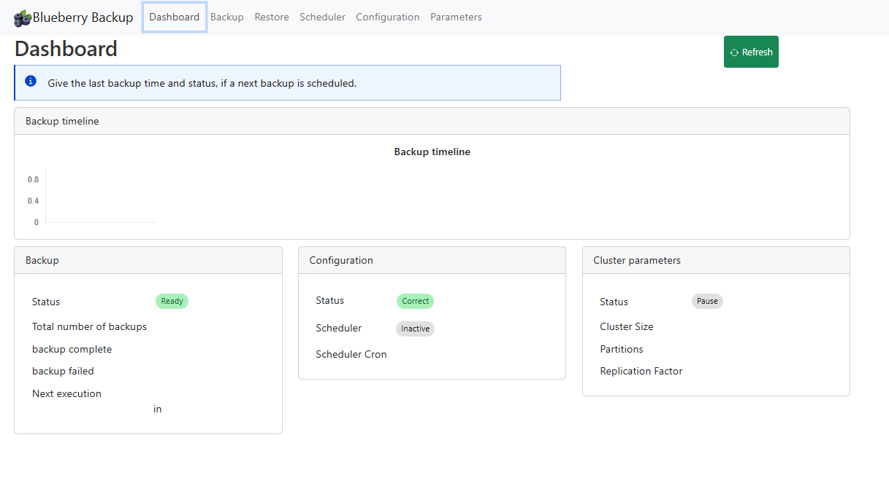
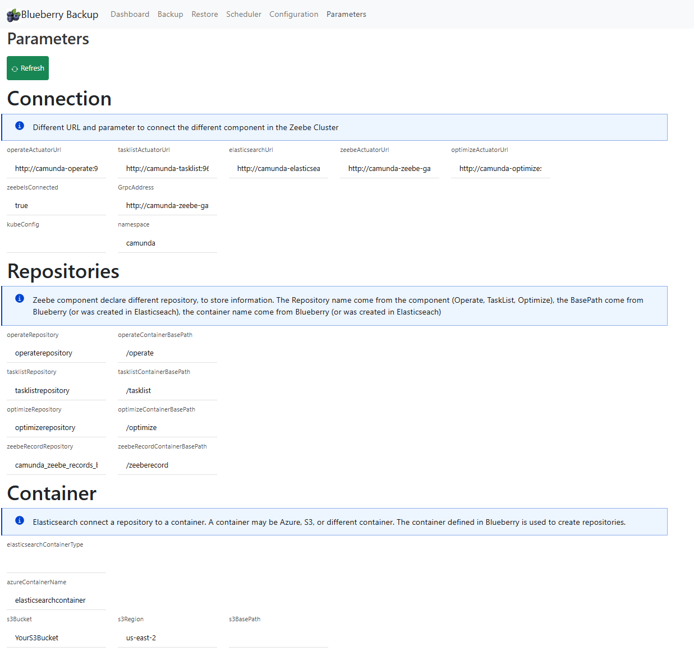

# Blueberry application

The Blueberry application is available under an image, and can be deployed via Kubernetes.
A kubernetes file is accessible into the k8 folder

Run this command
```shell
cd k8s
kubectl create -f blueberry.yaml
```

to stop it

```shell
cd k8s
kubectl delete -f blueberry.yaml
```


The application is accessible under port 9082. A simple way consist of "port-forward" the port to your PC

```shell
kubectl port-forward svc/blueberry-service 9082:9082 -n camunda
```

The application is accessible under localhost:9082

## Blueberry user interface

### Dashboard page
The dashboard shows backup status for the cluster.

The **Backup timeline** chart lists up to **20** most recent backup IDs from the merged backup list (newest first).
Bar colors reflect status: complete, partial, in progress, failed, or unknown.

The backup card shows these counts:

- Total backups
- Complete backups (all active components reported the ID)
- Partial backups (one or more active components did not report the ID)
- Failed backups
- **Latest backup** — highest backup ID, status, and time when available
- **In progress** — warning banner and step text while a backup job is running

The **Cluster parameters** card shows topology (size, partitions, replication factor) and **Zeebe exporter** status
(exporters enabled/disabled). This is not the same as broker export *pause* during backup; pause is handled inside the backup job.

**Scheduler** on the dashboard stays inactive until the scheduler feature is implemented (v2).

Use **Refresh** to reload dashboard data. The page auto-refreshes dashboard data every **2 minutes** and connections every **60 seconds**.

If the timeline is empty, either no backups exist yet or Blueberry cannot reach Zeebe/actuator endpoints (see Connection card).



### Backup page

The Backup home page displays all existing backups and allows you to start a new one.

To initiate a new backup, click "Start Backup." Blueberry will automatically calculate the next available backup ID and begin the process.

> This URL can be used in a Cron URL to start a backup at a frequency
 

If you need to start a backup with a specific ID, simply enter the desired ID and then start the backup manually.

### Backup completeness

Blueberry marks a backup **complete** when two conditions are true:

- The merged status is `COMPLETED`.
- Every active component reports that backup ID.

Blueberry marks a backup **partial** when the merged status is `COMPLETED` and one or more active components do not report that ID.

The Backup page shows the present components and the missing components for each ID.

Optimize is optional. If `blueberry.optimizeActuatorUrl` is empty, Blueberry omits Optimize from the required set.

A partial backup cannot start a restore. The Restore button stays disabled for a partial backup.


### Restore page

The Restore page lists backups from the same API as the Backup page.

Each row shows backup ID, time, status, and components.

1. Click **Restore** on a complete backup row.
2. Read the preflight result in the confirm dialog.
3. Click **Start restore** only when live restore is enabled.

For Camunda **8.10**, Start restore uses the **Restore API**: everything goes through the REST API of the cluster. There is no Kubernetes,
and the brokers are not restarted
([Elasticsearch](https://docs.camunda.io/docs/next/self-managed/operational-guides/backup-restore/elasticsearch/es-restore-api/),
[RDBMS](https://docs.camunda.io/docs/next/self-managed/operational-guides/backup-restore/rdbms/rdbms-restore-api/)).
The cluster is out of service during the restore.

1. Validate, before any change: the REST API answers, the Zeebe backup (`GET /v2/backups/runtime/{id}`) is `COMPLETED`, and the secondary
   storage has the backup (Elasticsearch: the snapshots `camunda_webapps_{id}_..._part_k_of_n`, `camunda_zeebe_records_backup_{id}`, and the
   index templates; a database: the backup file or the backup of the history). With Elasticsearch, **Optimize must be stopped**: the REST API
   can't stop it. Blueberry refuses to start while Optimize answers.
2. Recovery mode: `PATCH /v2/mode?mode=RECOVERING`. Blueberry waits until the partitions are in recovery mode.
3. Restore the secondary storage, the cluster stays in recovery mode.
   * Elasticsearch: a dry run of the restore of Zeebe (`POST /v2/restore?dryRun=true`), so nothing is deleted if Zeebe would refuse it. Then
     delete the indices (camunda, operate, tasklist, optimize, zeebe) and restore the snapshots one by one.
   * A database (PostgreSQL, SQL Server): the restore with the native tool of the database. Camunda has no API for it.
4. Restore Zeebe: `POST /v2/restore {"backupIds": [id]}` (for a database, after a dry run: Zeebe reads the exporter position in the restored
   database), then `GET /v2/restore` until it is finished.
5. The cluster leaves the recovery mode by itself. Blueberry checks `GET /v2/topology`.

If the restore fails before something is deleted, the cluster is put back in `PROCESSING` mode. After, it stays in recovery mode: fix the
cause, and start the restore again. Never start a partially restored cluster.
After the restore, check the data in Operate and Tasklist, and start Optimize.

Parameters: the REST API is `camunda.client.zeebe.restAddress` (or `blueberry.zeebeRestUrl`), with the basic authentication
`camunda.client.auth.username` and `password` (or `blueberry.zeebeRestUsername` and `blueberry.zeebeRestPassword`). The user needs the
permissions BACKUP and RESTORE. The time allowed is `blueberry.restore.zeebeRestoreTimeoutSeconds`.

#### Secondary storage

`blueberry.orchestrationConfig.secondaryStorage` gives the secondary storage when Blueberry can't detect it on the cluster.

| Value                | Backup                                                       | Restore                                         |
|----------------------|--------------------------------------------------------------|-------------------------------------------------|
| `elasticsearch`      | History backup (`POST /v2/backups/history`), then the snapshot of the Zeebe records | Delete the indices, restore the snapshots |
| `postgres`           | `pg_dump` (custom format) in `blueberry.postgres.backupDirectory` | `pg_restore --clean --single-transaction`  |
| `sqlserver`          | `BACKUP DATABASE` (T-SQL, by JDBC)                           | `RESTORE DATABASE ... WITH REPLACE`             |

PostgreSQL has no SQL command to back up, list or restore: Blueberry runs `pg_dump` and `pg_restore`, which must be installed where Blueberry
runs (the Docker image of Blueberry, or the package `postgresql-client`). The password is given by the environment variable `PGPASSWORD`.

```yaml
blueberry:
  secondaryStorage: postgres
  postgres:
    host: localhost
    port: 5432
    database: camunda
    username: camunda
    password: ...
    backupDirectory: /backups/postgres   # a directory of the machine where Blueberry runs
```

The restore of Camunda 8.7 (the PwC runbook with Kubernetes: stop the components, delete the volumes, `ZEEBE_RESTORE`) is not in the 2.0 branch.
It needs Operate and Tasklist, which are part of the orchestration cluster since 8.8. It stays in the branch `pr-54` (Blueberry 1.4).

Live restore stays off until `blueberry.restore.execution` is `true`.

The restore reads the snapshots in the **same repositories as the backup**: `operateRepository`, `tasklistRepository`,
`optimizeRepository` and `elasticsearch.zeebeRecordRepository` of the Blueberry configuration. There is no separate restore repository.
`GET /blueberry/api/configuration/repositories` returns, for each component, the repository of the configuration and the repository read
in the cluster (`/actuator/env` of the component). An empty `cluster` means that the component does not expose `env`:

```json
[{"name": "operate", "configuration": "operaterepository", "cluster": ""}]
```

The same table is displayed in the Backup, Restore and Parameters pages.
The Helm chart must be **12.1.0** or later. Older charts ignore `ZEEBE_RESTORE`.

If a step fails after the components were stopped, Blueberry restarts all the components: it removes the Zeebe restore variables
(`ZEEBE_RESTORE`, `ZEEBE_RESTORE_FROM_BACKUP_ID`) and scales every component to its original number of replicas. Without it, Zeebe stays down,
the list of the backups is not accessible, and no restore can be done. The failure is logged, with a warning: if the failure happens
after the index deletion, the Elasticsearch indices may be missing, and some snapshots may not be restored. If the restore fails before
any change (step 1 to 3), nothing was stopped, so there is nothing to restart.

Other Camunda minors keep a manual restore plan.

**API endpoints**

| Method | Path | Purpose |
|--------|------|---------|
| GET | `/blueberry/api/restore/readiness` | Kubernetes + Elasticsearch connectivity and workload presence |
| GET | `/blueberry/api/restore/phases` | Phase list for the active Camunda version |
| GET | `/blueberry/api/restore/preflight?backupId=` | Completeness gate before restore |
| POST | `/blueberry/api/restore/start` | Start restore plan (`{"backupId": n}`) |
| GET | `/blueberry/api/restore/monitor` | Progress and operation log |

The **Restore** button stays disabled when the backup is partial or incomplete.


#### Configuration needed for the restore
The Restore API needs no Kubernetes: Blueberry calls the REST API of the cluster and the secondary storage. It needs these parameters.

##### Parameters

| Parameter | Default | Purpose |
|-----------|---------|---------|
| `camunda.client.zeebe.restAddress` | `http://localhost:8080` | REST API of the cluster (`/v2/mode`, `/v2/restore`). Or `blueberry.zeebeRestUrl`. |
| `camunda.client.auth.username`, `password` | empty | Basic authentication of the REST API. The user needs the permissions BACKUP and RESTORE. |
| `blueberry.orchestrationConfig.secondaryStorage` | detected | `elasticsearch`, `postgres` or `sqlserver`, when the cluster does not give it |
| `blueberry.restore.execution` | `false` | Live restore stays off until this is `true` |
| `blueberry.elasticsearchurl` | `http://localhost:9200` | Elasticsearch used to restore the snapshots |

Check the environment with `GET /blueberry/api/restore/readiness` before starting a restore: the REST API answers, the secondary storage is known, and Optimize is stopped (Elasticsearch).

##### Google Cloud: access to the storage

The Google login above is for the **Kubernetes API**. The backups are written in a Google Cloud Storage bucket by Zeebe and Elasticsearch,
each with its own credentials, for example a service account key mounted from a Kubernetes secret
(`GOOGLE_APPLICATION_CREDENTIALS` for Zeebe, `gcs.client.default.credentials_file` in the Elasticsearch keystore).


### Camunda version selector

Use the version list in the top bar to select Camunda **8.7**, **8.8**, **8.9**, or **8.10**.

The selection is stored in the browser and sent to the server.

Doc links for backup and restore follow the selected version.
The default version is **8.7**.

### Scheduler page

In development

### Configuration page
The configuration page checks if the configuration is correct: do all parameters correctly set component per component?

Do all repositories be created on Elastic search?

If some configuration is missing, the page will detect it and notify you. Using the "Configure" button, some missing part can be created. For example, repository in Elastic search can be created if Blueberry know all the information.

See the configuration section.


## Configuration


Blueberry needs to access the repository name used by Operate, TaskList, Zeebe to check the configuration. 
For example:
````yaml
operate:
  env:
    - name: CAMUNDA_OPERATE_BACKUP_REPOSITORY_NAME
      value: "operaterepository"
      
tasklist:
  env:
    - name: CAMUNDA_TASKLIST_BACKUP_REPOSITORY_NAME
      value: "tasklistrepository"

zeebe:
  env:
    - name: ZEEBE_BROKER_DATA_BACKUP_GCS_BUCKETNAME
      value: "pym-pc8backup-20250411"
    - name: ZEEBE_BROKER_DATA_BACKUP_GCS_BASEPATH
      value: "zeebecontainer"
    - name: ZEEBE_BROKER_DATA_BACKUP_STORE
      value: "GCS"
````


to check the configuration or create repositories in ElasticSearch.

> Blueberry use first to access the actuator method (see below). If this is not accessible, it get values from the configuration

**Explicit definition in the application**

The first option is to provide this information in the application.yaml

```yaml
blueberry:
  operateRepository: operaterepository
  tasklistRepository: tasklistrepository
  optimizeRepository : optimizerepository
  zeebeRepository: zeeberecordrepository
```
> ATTENTION: these values must match exactly the same name


It is possible to override it on Kubernetes via some environment variable.

**Actuator environment**

Blueberry tries to access the actuator environment for each application. 
If this operation failed, it will use the information defined in the configuration.

The actuator access is not open by default by the Camunda application. 
It may contain passwords, so It is not recommended to open it permanently.

it can be opened only to configure backup, i.e. when you need to click on the `Check` or the `Configure` button, 
one time in the life of the system.


Blueberry calls `/actuator/env` on each application.

This is possible via adding variable `management.endpoints.web.exposure.include`
and the variable `management.endpoint.env.show.values` to `ALWAYS`.


````yaml
operate:
  env:
    - name: CAMUNDA_OPERATE_BACKUP_REPOSITORY_NAME
      value: "operaterepository"
    - name: management.endpoints.web.exposure.include
      value: health, prometheus, loggers, usage-metrics, backups, env
    - name: management.endpoint.env.show.values
      value: ALWAYS
      
tasklist:
  env:
    - name: CAMUNDA_TASKLIST_BACKUP_REPOSITORY_NAME
      value: "tasklistrepository"
    - name: management.endpoints.web.exposure.include
      value: health, prometheus, loggers, usage-metrics, backups, env
    - name: management.endpoint.env.show.values
      value: ALWAYS

zeebe:
  env:
    - name: ZEEBE_BROKER_DATA_BACKUP_GCS_BUCKETNAME
      value: "pym-pc8backup-20250411"
    - name: ZEEBE_BROKER_DATA_BACKUP_GCS_BASEPATH
      value: "zeebecontainer"
    - name: ZEEBE_BROKER_DATA_BACKUP_STORE
      value: "GCS"
    - name: management.endpoints.web.exposure.include
      value: health, prometheus, loggers, usage-metrics, backups, env
    - name: management.endpoint.env.show.values
      value: ALWAYS
````

> ATTENTION: opening this feature is considered as a security breach. You can open this only for the configuration step. When the configuration is done (Blueberry creates all repository in ElasticSearch), you can remove this entry

The default value contains already some entry, so redefine it implies to add all the default values. They are accessible here:
https://docs.camunda.io/docs/self-managed/operate-deployment/operate-configuration/#monitoring-operate


### Parameters page

The page shows the different parameters the application used. Check if all of your expected values are correctly available.




The configuration is available in the application.yaml, and thanks to SpringBoot, it can be overrided with environment variable


| Parameter                                                                | Description                                                                   | Default value                      |
|--------------------------------------------------------------------------|-------------------------------------------------------------------------------|------------------------------------|
| blueberry.optimizeActuatorUrl                                            | Url to access Optimize                                                        | http://camunda-optimize:9600       |
| blueberry.zeebeActuatorUrl                                               | Url to access Zeebe                                                           | http://camunda-zeebe-gateway:9600  | 
| blueberry.elasticsearchurl                                               | Url to access Elasticsearch                                                   | http://camunda-elasticsearch:9200  |
| ** This information are temporary. They must come from the pod itself ** |                                                                               |                                    | 
| blueberry.operateRepository                                              | Operate define a repository name, copy it here                                |                                    |
| blueberry.tasklistRepository                                             | Tasklist define a repository name, copy it here                               |                                    |
| blueberry.optimizeRepository                                             | Optimize define a repository name, copy it here                               |                                    |
| blueberry.zeebeRepository                                                | Zeebe define a repository name, copy it here                                  |                                    | 
|                                                                          |                                                                               |                                    | 
| blueberry.elasticsearch.operateContainerBasePath                         | In the container, folder to save the backup information                       | /operate                           |                           
| blueberry.elasticsearch.tasklistContainerBasePath                        | In the container, folder to save the backup information                       | /tasklist                          |
| blueberry.elasticsearch.optimizeContainerBasePath                        | In the container, folder to save the backup information                       | /optimize                          |
| blueberry.elasticsearch.zeebeRecordContainerBasePath                     | In the container, folder to save the backup information                       | /zeeberecord                       |
| blueberry.elasticsearch.zeebeRecordRepository                            | ZeebeRecord need a backup. Here is the name of the backup to be created       | camunda_zeebe_records_backup       |
| blueberry.elasticsearch.zeebeRecordBasePath                              | In the container, folder to save the backup information                       | zeeberecordbackup                  |
| _The next keys are parameters of the orchestration cluster: Blueberry reads them in /actuator/env of Zeebe first, and uses blueberry.orchestrationConfig when the actuator can't be reached or does not give the variable_ | | |
| blueberry.orchestrationConfig.container.containerType                                        | Define the container used by Zeebe and by ElasticSearch. Value: "azure", "s3", "gcs", "filesystem" | azure                              |
| blueberry.orchestrationConfig.azure.containerName                                  | If the type is azure, name of the container                                   | "YourAzureContainerName"           |
| blueberry.orchestrationConfig.s3.bucketName                                            | If the type is S3, name of the bucket                                         | "YourS3Bucket"                     |
| blueberry.orchestrationConfig.s3.region                                            | if the type is S3, region of the bucket                                       | "us-east-2"                        |
| blueberry.orchestrationConfig.filesystem.path                                      | If the type is filesystem, the directory of the Elasticsearch repository, as Elasticsearch sees it (path.repo must contain it) | "/usr/share/elasticsearch/backups/elasticsearch" |
| blueberry.orchestrationConfig.filesystem.basePath | If the type is filesystem, the directory of the Zeebe backup. Fallback of CAMUNDA_DATA_PRIMARYSTORAGE_BACKUP_FILESYSTEM_BASEPATH, read first in /actuator/env of Zeebe | "/usr/local/camunda/backups/zeebe" |


# Connect a local Blueberry to a cluster
Different port must be accessible to let Blueberry connect to the cluster.

A Blueberry running on your PC reaches the cluster in two ways:

* **Port-forward** (`kubectl port-forward`): one port of your PC is connected to one pod or service port.
* **Proxy** (`kubectl proxy`): one port of your PC (8001) gives access, through the Kubernetes API, to any service or pod of the cluster.

Both need a Kubernetes access on your PC: `gcloud auth login`, then `gcloud container clusters get-credentials ...`
(and the plugin `gke-gcloud-auth-plugin` on GKE). Replace `camunda` by your namespace, and `camunda-...` by the names of
your Helm release.

## What Blueberry must reach

| Element                         | Port  | Used for                                                                                           | Blueberry parameter                                |
|---------------------------------|-------|----------------------------------------------------------------------------------------------------|----------------------------------------------------|
| Zeebe gateway, REST API         | 8080  | The backup: pause/resume the exporting, runtime backup (`/v2/exporting`, `/v2/backups`).           | `camunda.client.zeebe.restAddress`                 |
| Zeebe gateway, gRPC             | 26500 | The Zeebe client: topology, version, cluster information.                                          | `camunda.client.zeebe.grpcAddress`                 |
| Zeebe, actuator (management)    | 9600  | Connection check, exporters, partitions, the configuration (`/actuator/env`).                      | `blueberry.zeebeActuatorUrl`, `blueberry.zeebeActuatorPodUrl` |
| Elasticsearch                   | 9200  | The snapshots of the secondary storage: list, repositories, restore.                               | `blueberry.elasticsearchurl`                       |
| Optimize, actuator (management) | 8092  | The Optimize backup.                                                                               | `blueberry.optimizeActuatorUrl`                    |

Since Camunda 8.8, Operate and Tasklist are part of the orchestration cluster (the Zeebe pods): they have no port of their own.
The Zeebe gateway service gives the three ports 8080, 9600 and 26500.

## Port-forward: the list of ports

```shell
# Zeebe: REST API (backup), gRPC (client), actuator (management)
kubectl port-forward svc/camunda-zeebe-gateway 8080:8080   -n camunda &
kubectl port-forward svc/camunda-zeebe-gateway 26500:26500 -n camunda &
kubectl port-forward svc/camunda-zeebe-gateway 9600:9600   -n camunda &

# One actuator per broker, if blueberry.zeebeActuatorPodUrl uses the broker number (see below)
kubectl port-forward pod/camunda-zeebe-0 9600:9600 -n camunda &
kubectl port-forward pod/camunda-zeebe-1 9601:9600 -n camunda &
kubectl port-forward pod/camunda-zeebe-2 9602:9600 -n camunda &

# Elasticsearch (the secondary storage)
kubectl port-forward svc/elasticsearch-master 9200:9200 -n camunda &

# Optimize (if Optimize is deployed)
kubectl port-forward svc/camunda-optimize 8092:8092 -n camunda &
```

The matching configuration:

```yaml
blueberry:
  zeebeActuatorUrl: http://localhost:9600
  # The url contains {BROKERID}: http://localhost:960{BROKERID} gives 9600, 9601, 9602
  zeebeActuatorPodUrl: http://localhost:960{BROKERID}
  elasticsearchurl: http://localhost:9200
  optimizeActuatorUrl: http://localhost:8092
camunda:
  client:
    zeebe:
      restAddress: http://localhost:8080
      grpcAddress: http://localhost:26500
```

Open in a browser, if you want to see the applications: `http://localhost:8080/operate` and `http://localhost:8080/tasklist`.

## Why a proxy: the pods restart

A `kubectl port-forward` is connected to **one pod**: even when it is started on a service, kubectl chooses a pod when it starts.
When this pod is deleted or restarted, the port-forward is broken (`lost connection to pod`), and it does not reconnect.

With the Restore API (Camunda 8.10) the brokers are **not restarted** by the restore: the cluster goes in recovery mode and comes back. A port-forward survives it.
The proxy is still the safer choice: a pod restart for any other reason (an upgrade, a node failure, the restore of Camunda 8.8 or 8.9 by the Restore Application, which stops all the components) breaks every port-forward.

The proxy does not have this issue. `kubectl proxy` goes through the Kubernetes API, which looks for the service or the pod
**at each request**: after a restart, the next request reaches the new pod. The proxy gives the access to the actuator and to the
REST API, and to all the pods, with only one port.

```shell
kubectl proxy --port=8001
```

The url of a service or of a pod through the proxy:

```
http://localhost:8001/api/v1/namespaces/{namespace}/services/{service}:{port}/proxy/{path}
http://localhost:8001/api/v1/namespaces/{namespace}/pods/{pod}:{port}/proxy/{path}
```

The configuration for the restore, with the proxy:

```yaml
blueberry:
  # Actuator of the Zeebe gateway, and of each broker (the pod name camunda-zeebe-0 is stable: it is a StatefulSet)
  zeebeActuatorUrl: http://localhost:8001/api/v1/namespaces/camunda/services/camunda-zeebe-gateway:9600/proxy
  zeebeActuatorPodUrl: http://localhost:8001/api/v1/namespaces/camunda/pods/camunda-zeebe-{BROKERID}:9600/proxy
  optimizeActuatorUrl: http://localhost:8001/api/v1/namespaces/camunda/services/camunda-optimize:8092/proxy
  # Elasticsearch is not stopped by the restore: a port-forward is enough
  elasticsearchurl: http://localhost:9200
camunda:
  client:
    zeebe:
      # The proxy is HTTP: the Zeebe client uses the REST API. The gRPC port (26500) can't go through the proxy.
      preferRestOverGrpc: true
      restAddress: http://localhost:8001/api/v1/namespaces/camunda/services/camunda-zeebe-gateway:8080/proxy
      grpcAddress: http://localhost:26500
```

Remarks:

* The proxy is HTTP only. The gRPC port 26500 can't go through it: that is why the REST address is used (`preferRestOverGrpc: true`).
  The backup (pause, runtime backup) uses the REST API only, so it works with the proxy.
* The proxy uses your Kubernetes credentials (the `gcloud` login): Blueberry gives no credentials to the proxy.
  The request of the actuator through the proxy is a request to the Kubernetes API: your account needs the right to read the services and pods.
* Elasticsearch is not stopped by the restore (all the other components are). A simple port-forward on `elasticsearch-master`
  works. The proxy works too: `.../services/elasticsearch-master:9200/proxy`.
* Keep `kubectl proxy` open in one terminal, and the port-forward you need (Elasticsearch) in another.

## Check the access

```shell
# Through a port-forward: 401 or 200 means that the REST API answers (it asks for a login)
curl -s -o /dev/null -w "%{http_code}\n" http://localhost:8080/v2/topology

# Through the proxy
curl -s -o /dev/null -w "%{http_code}\n" http://localhost:8001/api/v1/namespaces/camunda/services/camunda-zeebe-gateway:9600/proxy/actuator/health
```

* `Unable to listen on port ...: address already in use`: another port-forward, or another program, already uses this port of your PC.
* From Windows, with `kubectl` running in WSL: Windows may not reach the ports of WSL. Start the commands in the same system as Blueberry.


# Topics

Check the [Development.md](../dev/Development.md)


## Filesystem container (Docker Compose)

A directory shared by Elasticsearch and Zeebe (a Docker volume) can be the container of the backups.

```yaml
blueberry:
  zeebeActuatorUrl: http://localhost:9600
  elasticsearchurl: http://localhost:9200
  elasticsearch:
    enabled: true
    zeebeRecordRepository: camunda        # the name of the Elasticsearch repository
  container:
    containerType: filesystem
    filesystem:
      path: /usr/share/elasticsearch/backups/elasticsearch   # as Elasticsearch sees it
```

**Elasticsearch repository.** The **Configure** button creates it (the rule of the repository does it when it does not exist). It sends

```shell
PUT /_snapshot/camunda
{"type": "fs", "settings": {"location": "/usr/share/elasticsearch/backups/elasticsearch"}}
```

which is the same as `docker exec elasticsearch curl -XPUT http://localhost:9200/_snapshot/camunda ...`. It creates the **repository** where the
snapshots will be written: a snapshot is created later by the backup. Elasticsearch accepts it if:

* `path.repo` contains the directory (`path.repo=/usr/share/elasticsearch/backups` in the environment of the container),
* the directory exists and is writable by the user of Elasticsearch.

All the rules use one repository (`zeebeRecordRepository` and `optimizeRepository` with the same name): two repositories can't have the same location.

**Zeebe.** The rule "Zeebe Container" reads the backup store of Zeebe in `/actuator/env`:

```
CAMUNDA_DATA_PRIMARYSTORAGE_BACKUP_STORE=FILESYSTEM
CAMUNDA_DATA_PRIMARYSTORAGE_BACKUP_FILESYSTEM_BASEPATH=/usr/local/camunda/backups/zeebe
```

and checks that the store is the container type of Blueberry (`filesystem`), and that the directory of Zeebe is defined. The environment of the
orchestration must let Blueberry read it:

```yaml
- MANAGEMENT_ENDPOINTS_WEB_EXPOSURE_INCLUDE=health,prometheus,loggers,usage-metrics,env,configprops,exporters,partitions,cluster,backupRuntime,backupHistory,exporting
- MANAGEMENT_ENDPOINT_ENV_ACCESS=unrestricted
- MANAGEMENT_ENDPOINT_ENV_SHOWVALUES=ALWAYS
- MANAGEMENT_ENDPOINT_CONFIGPROPS_ACCESS=unrestricted
- MANAGEMENT_ENDPOINT_CONFIGPROPS_SHOWVALUES=ALWAYS
```

Development only: the values of the environment (passwords too) are visible on the management port. The same rule reads the older variables
(`ZEEBE_BROKER_DATA_BACKUP_*`) and the properties of the configuration file (`camunda.data.primary-storage.backup.*`) too.
