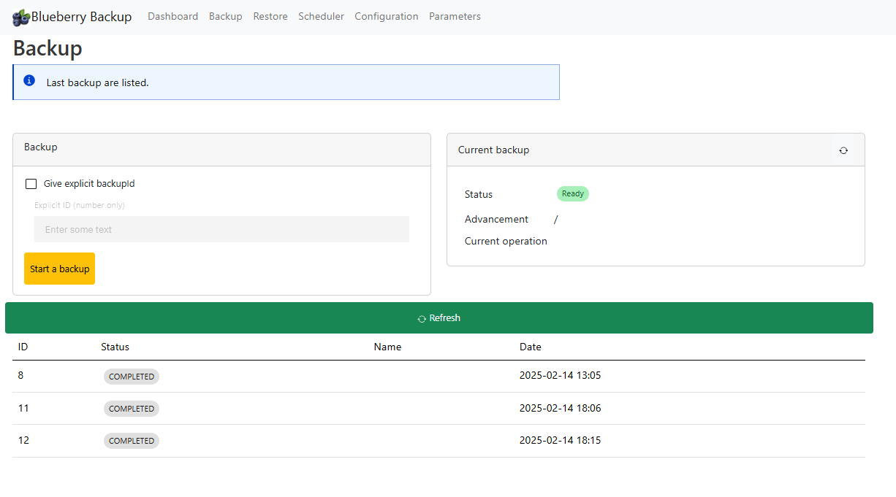
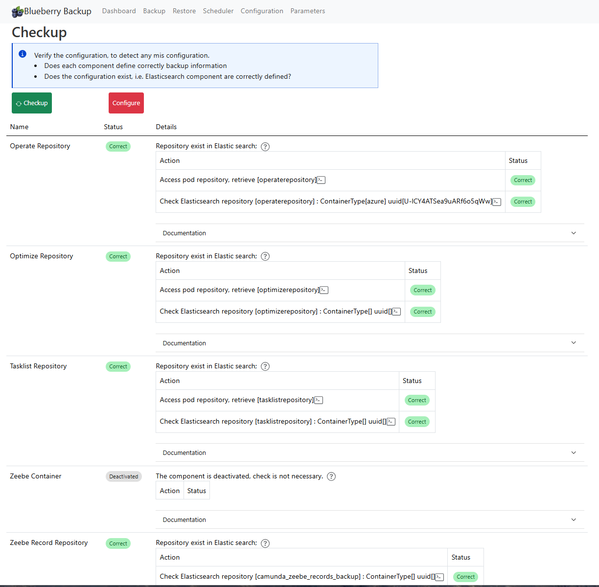

# Blueberry application

The Blueberry application is available under an image, and can be deployed via Kubernetes.
A kubernetes file is accessible into the k8 folder

Run this command
```shell
cd k8s
kubectl create -f blueberry.yaml
```

to stop it

```shell
cd k8s
kubectl delete -f blueberry.yaml
```


The application is accessible under port 9082. A simple way consist of "port-forward" the port to your PC

```shell
kubectl port-forward svc/blueberry-service 9082:9082 -n camunda
```

The application is accessible under localhost:9082

## Blueberry user interface

### Dashboard page
The dashboard gives you a main overview on the backup.


### Backup page

The Backup home page displays all existing backups and allows you to start a new one.

To initiate a new backup, click "Start Backup." Blueberry will automatically calculate the next available backup ID and begin the process.

> This URL can be used in a Cron URL to start a backup at a frequency
 

If you need to start a backup with a specific ID, simply enter the desired ID and then start the backup manually.




### Restore page

In development

### Scheduler page

In development

### Configuration page
The configuration page checks if the configuration is correct: do all parameters correctly set component per component?

Do all repositories be created on Elastic search?

If some configuration is missing, the page will detect it and notify you. Using the "Configure" button, some missing part can be created. For example, repository in Elastic search can be created if Blueberry know all the information.

See the configuration section.




## Configuration


Blueberry needs to access the repository name used by Operate, TaskList, Zeebe to check the configuration. 
For example:
````yaml
operate:
  env:
    - name: CAMUNDA_OPERATE_BACKUP_REPOSITORY_NAME
      value: "operaterepository"
      
tasklist:
  env:
    - name: CAMUNDA_TASKLIST_BACKUP_REPOSITORY_NAME
      value: "tasklistrepository"

zeebe:
  env:
    - name: ZEEBE_BROKER_DATA_BACKUP_GCS_BUCKETNAME
      value: "pym-pc8backup-20250411"
    - name: ZEEBE_BROKER_DATA_BACKUP_GCS_BASEPATH
      value: "zeebecontainer"
    - name: ZEEBE_BROKER_DATA_BACKUP_STORE
      value: "GCS"
````


to check the configuration or create repositories in ElasticSearch.

> Blueberry use first to access the actuator method (see below). If this is not accessible, it get values from the configuration

**Explicit definition in the application**

The first option is to provide this information in the application.yaml

```yaml
blueberry:
  operateRepository: operaterepository
  tasklistRepository: tasklistrepository
  optimizeRepository : optimizerepository
  zeebeRepository: zeeberecordrepository
```
> ATTENTION: these values must match exactly the same name


It is possible to override it on Kubernetes via some environment variable.

**Actuator environment**

Blueberry tries to access the actuator environment for each application. 
If this operation failed, it will use the information defined in the configuration.

The actuator access is not open by default by the Camunda application. 
It may contain passwords, so It is not recommended to open it permanently.

it can be opened only to configure backup, i.e. when you need to click on the `Check` or the `Configure` button, 
one time in the life of the system.


Blueberry calls `/actuator/env` on each application.

This is possible via adding variable `management.endpoints.web.exposure.include`
and the variable `management.endpoint.env.show.values` to `ALWAYS`.


````yaml
operate:
  env:
    - name: CAMUNDA_OPERATE_BACKUP_REPOSITORY_NAME
      value: "operaterepository"
    - name: management.endpoints.web.exposure.include
      value: health, prometheus, loggers, usage-metrics, backup, env
    - name: management.endpoint.env.show.values
      value: ALWAYS
      
tasklist:
  env:
    - name: CAMUNDA_TASKLIST_BACKUP_REPOSITORY_NAME
      value: "tasklistrepository"
    - name: management.endpoints.web.exposure.include
      value: health, prometheus, loggers, usage-metrics, backup, env
    - name: management.endpoint.env.show.values
      value: ALWAYS

zeebe:
  env:
    - name: ZEEBE_BROKER_DATA_BACKUP_GCS_BUCKETNAME
      value: "pym-pc8backup-20250411"
    - name: ZEEBE_BROKER_DATA_BACKUP_GCS_BASEPATH
      value: "zeebecontainer"
    - name: ZEEBE_BROKER_DATA_BACKUP_STORE
      value: "GCS"
    - name: management.endpoints.web.exposure.include
      value: health, prometheus, loggers, usage-metrics, backup, env
    - name: management.endpoint.env.show.values
      value: ALWAYS
````

> ATTENTION: opening this feature is considered as a security breach. You can open this only for the configuration step. When the configuration is done (Blueberry creates all repository in ElasticSearch), you can remove this entry

The default value contains already some entry, so redefine it implies to add all the default values. They are accessible here:
https://docs.camunda.io/docs/self-managed/operate-deployment/operate-configuration/#monitoring-operate


### Parameters page

The page shows the different parameters the application used. Check if all of your expected values are correctly available.


The configuration is available in the application.yaml, and thanks to SpringBoot, it can be overrided with environment variable


| Parameter                                                                | Description                                                                   | Default value                      |
|--------------------------------------------------------------------------|-------------------------------------------------------------------------------|------------------------------------|
| blueberry.optimizeActuatorUrl                                            | Url to access Optimize                                                        | http://camunda-optimize:9600       |
| blueberry.zeebeActuatorUrl                                               | Url to access Zeebe                                                           | http://camunda-zeebe-gateway:9600  | 
| blueberry.elasticsearchurl                                               | Url to access Elasticsearch                                                   | http://camunda-elasticsearch:9200  |
| ** This information are temporary. They must come from the pod itself ** |                                                                               |                                    | 
| blueberry.operateRepository                                              | Operate define a repository name, copy it here                                |                                    |
| blueberry.tasklistRepository                                             | Tasklist define a repository name, copy it here                               |                                    |
| blueberry.optimizeRepository                                             | Optimize define a repository name, copy it here                               |                                    |
| blueberry.zeebeRepository                                                | Zeebe define a repository name, copy it here                                  |                                    | 
|                                                                          |                                                                               |                                    | 
| blueberry.elasticsearch.operateContainerBasePath                         | In the container, folder to save the backup information                       | /operate                           |                           
| blueberry.elasticsearch.tasklistContainerBasePath                        | In the container, folder to save the backup information                       | /tasklist                          |
| blueberry.elasticsearch.optimizeContainerBasePath                        | In the container, folder to save the backup information                       | /optimize                          |
| blueberry.elasticsearch.zeebeRecordContainerBasePath                     | In the container, folder to save the backup information                       | /zeeberecord                       |
| blueberry.elasticsearch.zeebeRecordRepository                            | ZeebeRecord need a backup. Here is the name of the backup to be created       | camunda_zeebe_records_backup       |
| blueberry.elasticsearch.zeebeRecordBasePath                              | In the container, folder to save the backup information                       | zeeberecordbackup                  |
| blueberry.container.containerType                                        | Define the container used by Zeebe and by ElasticSearch. Value: "azure", "s3" | azure                              |
| blueberry.container.azure.containerName                                  | If the type is azure, name of the container                                   | "YourAzureContainerName"           |
| blueberry.container.s3.bucket                                            | If the type is S3, name of the bucket                                         | "YourS3Bucket"                     |
| blueberry.container.s3.region                                            | if the type is S3, region of the bucket                                       | "us-east-2"                        |


# Connect a local Blueberry to a cluster
Different port must be accessible to let Blueberry connect to the cluster.

A Blueberry running on your PC reaches the cluster in two ways:

* **Port-forward** (`kubectl port-forward`): one port of your PC is connected to one pod or service port.
* **Proxy** (`kubectl proxy`): one port of your PC (8001) gives access, through the Kubernetes API, to any service or pod of the cluster.

Both need a Kubernetes access on your PC: `gcloud auth login`, then `gcloud container clusters get-credentials ...`
(and the plugin `gke-gcloud-auth-plugin` on GKE). Replace `camunda` by your namespace, and `camunda-...` by the names of
your Helm release.

## What Blueberry must reach

| Element                         | Port  | Used for                                                                                           | Blueberry parameter                                |
|---------------------------------|-------|----------------------------------------------------------------------------------------------------|----------------------------------------------------|
| Zeebe gateway, REST API         | 8080  | The backup: pause/resume the exporting, runtime backup (`/v2/exporting`, `/v2/backups`).           | `camunda.client.zeebe.restAddress`                 |
| Zeebe gateway, gRPC             | 26500 | The Zeebe client: topology, version, cluster information.                                          | `camunda.client.zeebe.grpcAddress`                 |
| Zeebe, actuator (management)    | 9600  | Connection check, exporters, partitions, the configuration (`/actuator/env`).                      | `blueberry.zeebeActuatorUrl`, `blueberry.zeebeActuatorPodUrl` |
| Elasticsearch                   | 9200  | The snapshots of the secondary storage: list, repositories, restore.                               | `blueberry.elasticsearchurl`                       |
| Optimize, actuator (management) | 8092  | The Optimize backup.                                                                               | `blueberry.optimizeActuatorUrl`                    |
| Kubernetes API                  | 443   | The restore: stop and start the components, delete the volumes of Zeebe, read the pods.            | `blueberry.kubeConfig`                             |

Since Camunda 8.8, Operate and Tasklist are part of the orchestration cluster (the Zeebe pods): they have no port of their own.
The Zeebe gateway service gives the three ports 8080, 9600 and 26500.

## Port-forward: the list of ports

```shell
# Zeebe: REST API (backup), gRPC (client), actuator (management)
kubectl port-forward svc/camunda-zeebe-gateway 8080:8080   -n camunda &
kubectl port-forward svc/camunda-zeebe-gateway 26500:26500 -n camunda &
kubectl port-forward svc/camunda-zeebe-gateway 9600:9600   -n camunda &

# One actuator per broker, if blueberry.zeebeActuatorPodUrl uses the broker number (see below)
kubectl port-forward pod/camunda-zeebe-0 9600:9600 -n camunda &
kubectl port-forward pod/camunda-zeebe-1 9601:9600 -n camunda &
kubectl port-forward pod/camunda-zeebe-2 9602:9600 -n camunda &

# Elasticsearch (the secondary storage)
kubectl port-forward svc/elasticsearch-master 9200:9200 -n camunda &

# Optimize (if Optimize is deployed)
kubectl port-forward svc/camunda-optimize 8092:8092 -n camunda &
```

The matching configuration:

```yaml
blueberry:
  zeebeActuatorUrl: http://localhost:9600
  # The url contains {BROKERID}: http://localhost:960{BROKERID} gives 9600, 9601, 9602
  zeebeActuatorPodUrl: http://localhost:960{BROKERID}
  elasticsearchurl: http://localhost:9200
  optimizeActuatorUrl: http://localhost:8092
camunda:
  client:
    zeebe:
      restAddress: http://localhost:8080
      grpcAddress: http://localhost:26500
```

Open in a browser, if you want to see the applications: `http://localhost:8080/operate` and `http://localhost:8080/tasklist`.

## Why a proxy: the restore restarts the pods

A `kubectl port-forward` is connected to **one pod**: even when it is started on a service, kubectl chooses a pod when it starts.
When this pod is deleted or restarted, the port-forward is broken (`lost connection to pod`), and it does not reconnect.

The restore stops the components (Zeebe, the gateway, Optimize), deletes the volumes of Zeebe, then starts the components again.
So during the restore, and when it ends, all the port-forward of the Zeebe pods are broken. Blueberry can't call the actuator
or the REST API any more: it can't see that Zeebe is restarted, nor the result of the restore. You must stop the port-forward
and start them again by hand.

The proxy does not have this issue. `kubectl proxy` goes through the Kubernetes API, which looks for the service or the pod
**at each request**: after a restart, the next request reaches the new pod. The proxy gives the access to the actuator and to the
REST API, and to all the pods, with only one port.

```shell
kubectl proxy --port=8001
```

The url of a service or of a pod through the proxy:

```
http://localhost:8001/api/v1/namespaces/{namespace}/services/{service}:{port}/proxy/{path}
http://localhost:8001/api/v1/namespaces/{namespace}/pods/{pod}:{port}/proxy/{path}
```

The configuration for the restore, with the proxy:

```yaml
blueberry:
  # Actuator of the Zeebe gateway, and of each broker (the pod name camunda-zeebe-0 is stable: it is a StatefulSet)
  zeebeActuatorUrl: http://localhost:8001/api/v1/namespaces/camunda/services/camunda-zeebe-gateway:9600/proxy
  zeebeActuatorPodUrl: http://localhost:8001/api/v1/namespaces/camunda/pods/camunda-zeebe-{BROKERID}:9600/proxy
  optimizeActuatorUrl: http://localhost:8001/api/v1/namespaces/camunda/services/camunda-optimize:8092/proxy
  # Elasticsearch is not stopped by the restore: a port-forward is enough
  elasticsearchurl: http://localhost:9200
  # The access to the Kubernetes API for the restore (a kubeconfig which uses the proxy, or your kubeconfig)
  kubeConfig: src/main/resources/kube-proxy.yaml
camunda:
  client:
    zeebe:
      # The proxy is HTTP: the Zeebe client uses the REST API. The gRPC port (26500) can't go through the proxy.
      preferRestOverGrpc: true
      restAddress: http://localhost:8001/api/v1/namespaces/camunda/services/camunda-zeebe-gateway:8080/proxy
      grpcAddress: http://localhost:26500
```

Remarks:

* The proxy is HTTP only. The gRPC port 26500 can't go through it: that is why the REST address is used (`preferRestOverGrpc: true`).
  The backup (pause, runtime backup) uses the REST API only, so it works with the proxy.
* The proxy uses your Kubernetes credentials (the `gcloud` login): Blueberry gives no credentials to the proxy.
  The request of the actuator through the proxy is a request to the Kubernetes API: your account needs the right to read the services and pods.
* Elasticsearch is not stopped by the restore (all the other components are). A simple port-forward on `elasticsearch-master`
  works. The proxy works too: `.../services/elasticsearch-master:9200/proxy`.
* Keep `kubectl proxy` open in one terminal, and the port-forward you need (Elasticsearch) in another.

## Check the access

```shell
# Through a port-forward: 401 or 200 means that the REST API answers (it asks for a login)
curl -s -o /dev/null -w "%{http_code}\n" http://localhost:8080/v2/topology

# Through the proxy
curl -s -o /dev/null -w "%{http_code}\n" http://localhost:8001/api/v1/namespaces/camunda/services/camunda-zeebe-gateway:9600/proxy/actuator/health
```

* `Unable to listen on port ...: address already in use`: another port-forward, or another program, already uses this port of your PC.
* From Windows, with `kubectl` running in WSL: Windows may not reach the ports of WSL. Start the commands in the same system as Blueberry.


# Topics

Check the [Development.md](../dev/Development.md)

