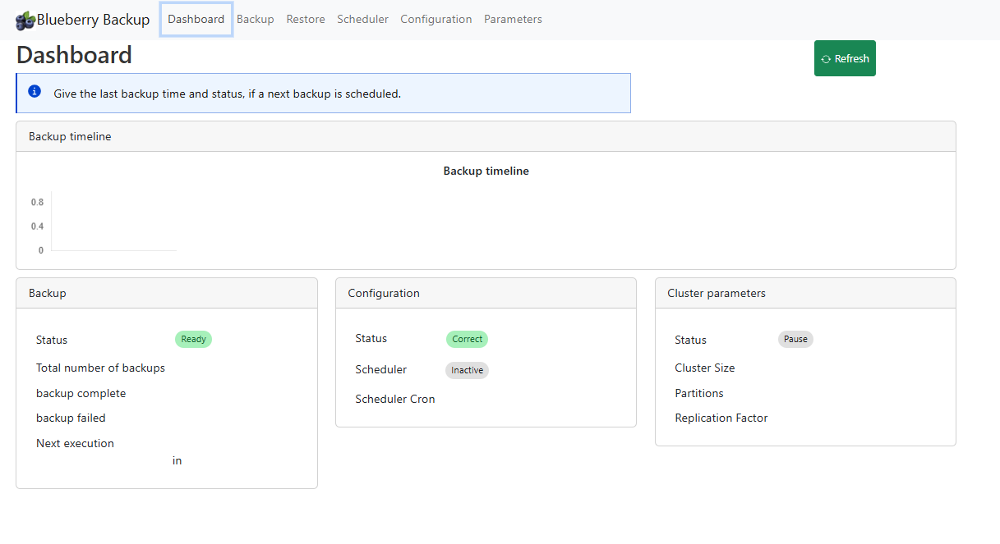
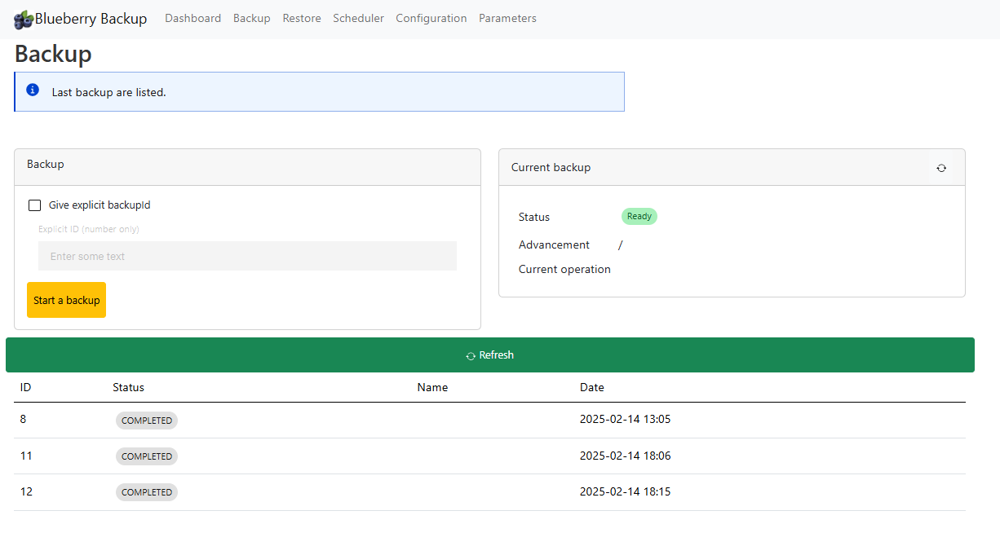
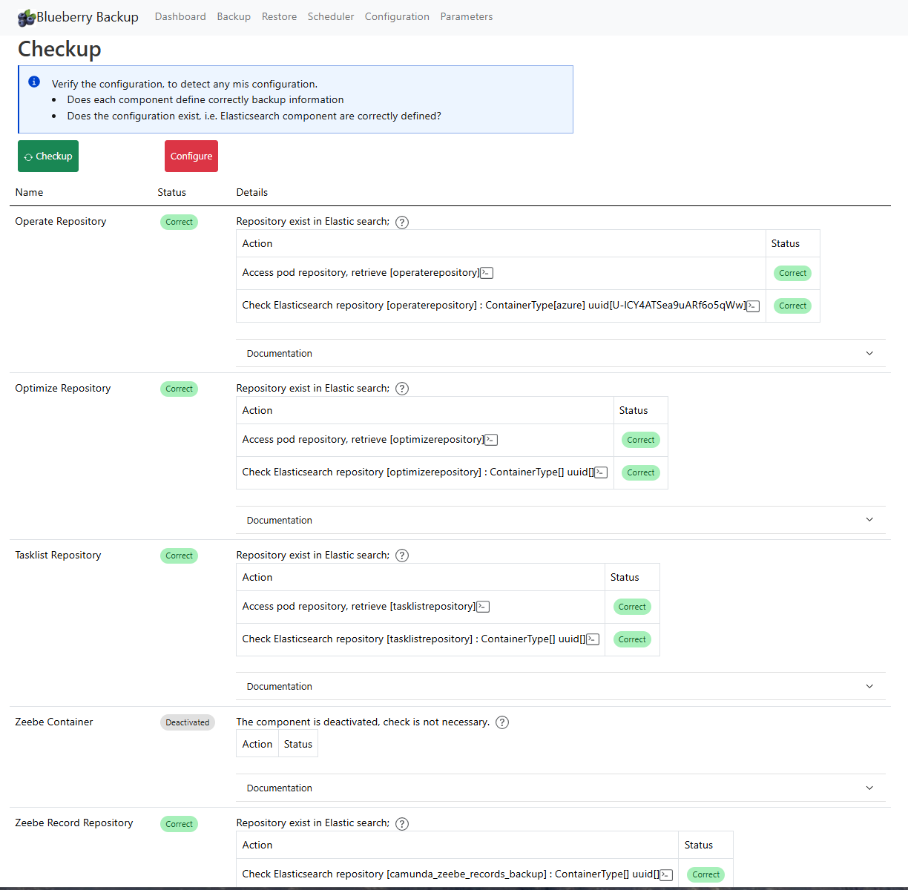
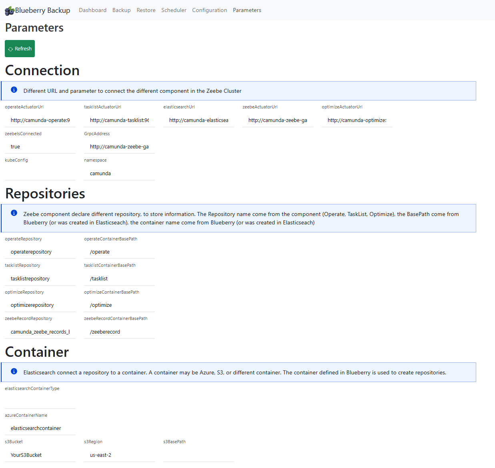

# Blueberry application

The Blueberry application is available under an image, and can be deployed via Kubernetes.
A kubernetes file is accessible into the k8 folder

Run this command
```shell
cd k8s
kubectl create -f blueberry.yaml
```

to stop it

```shell
cd k8s
kubectl delete -f blueberry.yaml
```


The application is accessible under port 9082. A simple way consist of "port-forward" the port to your PC

```shell
kubectl port-forward svc/blueberry-service 9082:9082 -n camunda
```

The application is accessible under localhost:9082

## Blueberry user interface

### Dashboard page
The dashboard shows backup status for the cluster.

The **Backup timeline** chart lists up to **20** most recent backup IDs from the merged backup list (newest first).
Bar colors reflect status: complete, partial, in progress, failed, or unknown.

The backup card shows these counts:

- Total backups
- Complete backups (all active components reported the ID)
- Partial backups (one or more active components did not report the ID)
- Failed backups
- **Latest backup** — highest backup ID, status, and time when available
- **In progress** — warning banner and step text while a backup job is running

The **Cluster parameters** card shows topology (size, partitions, replication factor) and **Zeebe exporter** status
(exporters enabled/disabled). This is not the same as broker export *pause* during backup; pause is handled inside the backup job.

**Scheduler** on the dashboard stays inactive until the scheduler feature is implemented (v2).

Use **Refresh** to reload dashboard data. The page auto-refreshes dashboard data every **2 minutes** and connections every **60 seconds**.

If the timeline is empty, either no backups exist yet or Blueberry cannot reach Zeebe/actuator endpoints (see Connection card).



### Backup page

The Backup home page displays all existing backups and allows you to start a new one.

To initiate a new backup, click "Start Backup." Blueberry will automatically calculate the next available backup ID and begin the process.

> This URL can be used in a Cron URL to start a backup at a frequency
 

If you need to start a backup with a specific ID, simply enter the desired ID and then start the backup manually.

### Backup completeness

Blueberry marks a backup **complete** when two conditions are true:

- The merged status is `COMPLETED`.
- Every active component reports that backup ID.

Blueberry marks a backup **partial** when the merged status is `COMPLETED` and one or more active components do not report that ID.

The Backup page shows the present components and the missing components for each ID.

Optimize is optional. If `blueberry.optimizeActuatorUrl` is empty, Blueberry omits Optimize from the required set.

A partial backup cannot start a restore. The Restore button stays disabled for a partial backup.




### Restore page

The Restore page lists backups from the same API as the Backup page.

Each row shows backup ID, time, status, and components.

1. Click **Restore** on a complete backup row.
2. Read the preflight result in the confirm dialog.
3. Click **Start restore** only when live restore is enabled.

For Camunda **8.7**, Start restore follows the PwC 8.7 runbook:

1. Validate the backup and the environment, before any change. Blueberry checks that the Camunda workloads exist in Kubernetes,
   that Zeebe has replicas, and that Elasticsearch answers. It reads the snapshots of the backup ID in the repository of each component,
   and checks that every component has a complete set of snapshots. If something is missing, the restore stops with the way to check it
   (`curl` commands): nothing has been stopped or deleted.
2. Check that Elasticsearch has index templates for operate, tasklist and zeebe (the composable and the legacy templates are both read).
   Optimize is not checked: it creates its own indices, and only some of them have templates. If the templates exist, go to the next step.
3. Create the missing templates. Blueberry deploys a process in Zeebe (start event, signal catch event, end event), creates one instance,
   and sends the signal. The process id and the signal name are random, like `blueberry_434243535434`.
   Then it checks the templates every 2 seconds, up to 10 times. If a template is still missing, the restore stops with the list of the
   missing ones and the `curl` commands to check them. Nothing has been stopped or deleted yet.
4. Stop Operate, Tasklist, Optimize, the Zeebe gateway, and Zeebe. Elasticsearch stays up.
5. Start the components once so they create index templates, then stop them again.
6. Delete indices whose names contain operate, tasklist, optimize, or zeebe.
7. Restore each snapshot for that backup ID. The request has no index filter.
8. Delete Zeebe persistent volume claims.
9. Set `ZEEBE_RESTORE=true` and `ZEEBE_RESTORE_FROM_BACKUP_ID` on the Zeebe StatefulSet, then scale the brokers up.
   With `ZEEBE_RESTORE=true`, the main container of each broker runs the restore, then exits: Kubernetes starts it again, the restore
   finds a data directory which is not empty, and aborts, again and again, until the variable is removed (step 10).
   The log of the first run is lost after a restart, so Blueberry watches every broker at the same time (one thread per broker, current
   and previous run of the container) and accepts one of two messages. The log of the restore tells which one it detected:
   * `Successfully restored broker from backup`: the restore was seen.
   * `... is not empty. Aborting restore to avoid overwriting data`: the container restarted after a first restore, which wrote the
     data. The restore of this broker is considered successful.

   If a broker logs none of them in the time allowed (`blueberry.restore.zeebeRestoreTimeoutSeconds`), the restore stops with the list of
   the brokers not detected.
10. Remove those variables, start the other components, and restart Zeebe.
11. Cluster restarted: wait until the Zeebe brokers (`blueberry.restore.zeebeRestoreTimeoutSeconds`) and the other components are ready.
    The restore is finished, and its status changes, only after this step.

The restore must then be validated manually: open Operate, Tasklist and Optimize, check the data from the backup time, and start one test process.

The templates are created by Operate and Tasklist when they start. Zeebe creates its templates when its exporter exports records:
this is why step 3 deploys a process.

Live restore stays off until `blueberry.restore.execution` is `true`.
Restore uses the **Kubernetes API** (Fabric8) and **Elasticsearch HTTP** — not shell scripts or simulated steps.
Set `blueberry.kubeConfig` when Blueberry runs outside the cluster.

If your kubeconfig includes **GKE** (`gke-gcloud-auth-plugin`) and **local** clusters (kind, Docker Desktop),
set `blueberry.kubeContext` to the cluster you want (for example `kind-camunda-platform-local`). Blueberry uses
that context instead of whatever is selected in `kubectl config current-context`.

On startup, Fabric8 may log `Error unmarshalling ExecCredential` when the GKE plugin returns non-JSON output
(expired `gcloud` login, plugin not on `PATH` for the JVM, or wrong context). That is usually a **WARN**, not a
crash. Fix GKE auth with:

```shell
gcloud auth login
gcloud container clusters get-credentials YOUR_CLUSTER --region YOUR_REGION
kubectl get nodes
which gke-gcloud-auth-plugin
```

Ensure the same `PATH` is visible to the process that starts Blueberry (IDE run configuration or terminal).
Check `GET /blueberry/api/restore/readiness` before you start.
The Helm release default is `camunda87helm` in namespace `camunda`.
The restore reads the snapshots in the **same repositories as the backup**: `operateRepository`, `tasklistRepository`,
`optimizeRepository` and `elasticsearch.zeebeRecordRepository` of the Blueberry configuration. There is no separate restore repository.
`GET /blueberry/api/configuration/repositories` returns, for each component, the repository of the configuration and the repository read
in the cluster (`/actuator/env` of the component). An empty `cluster` means that the component does not expose `env`:

```json
[{"name": "operate", "configuration": "operaterepository", "cluster": ""}]
```

The same table is displayed in the Backup, Restore and Parameters pages.
The Helm chart must be **12.1.0** or later. Older charts ignore `ZEEBE_RESTORE`.

If a step fails after the components were stopped, Blueberry restarts all the components: it removes the Zeebe restore variables
(`ZEEBE_RESTORE`, `ZEEBE_RESTORE_FROM_BACKUP_ID`) and scales every component to its original number of replicas. Without it, Zeebe stays down,
the list of the backups is not accessible, and no restore can be done. The failure is logged, with a warning: if the failure happens
after the index deletion, the Elasticsearch indices may be missing, and some snapshots may not be restored. If the restore fails before
any change (step 1 to 3), nothing was stopped, so there is nothing to restart.

Other Camunda minors keep a manual restore plan.

**API endpoints**

| Method | Path | Purpose |
|--------|------|---------|
| GET | `/blueberry/api/restore/readiness` | Kubernetes + Elasticsearch connectivity and workload presence |
| GET | `/blueberry/api/restore/phases` | Phase list for the active Camunda version |
| GET | `/blueberry/api/restore/preflight?backupId=` | Completeness gate before restore |
| POST | `/blueberry/api/restore/start` | Start restore plan (`{"backupId": n}`) |
| GET | `/blueberry/api/restore/monitor` | Progress and operation log |

The **Restore** button stays disabled when the backup is partial or incomplete.


#### Configuration needed for the restore
The blueberry application needs to be configured with the following parameters in order to perform a restore. It needs to access the Kubernetes API,
to scale the Camunda components down and up, and Elasticsearch, to restore the snapshots.

##### Parameters

| Parameter | Default | Purpose |
|-----------|---------|---------|
| `blueberry.kubeConfig` | empty | Path to a kubeconfig file. Needed when Blueberry runs **outside** the cluster. Leave it empty when Blueberry runs inside the cluster. |
| `blueberry.namespace` | `camunda` | Kubernetes namespace of the Camunda platform |
| `blueberry.restore.helmRelease` | `camunda87helm` | Helm release name. The deployments are named `<release>-operate`, `<release>-tasklist`... Use the release name given by `helm list -n camunda`. |
| `blueberry.restore.execution` | `false` | Live restore stays off until this is `true` |
| `blueberry.elasticsearchurl` | `http://localhost:9200` | Elasticsearch used to restore the snapshots |

Check the connection with `GET /blueberry/api/restore/readiness` before starting a restore.

##### How Blueberry connects to Kubernetes

Blueberry uses the Kubernetes client (Fabric8). It chooses the configuration in this order:

1. `blueberry.kubeConfig`, if it is set: Blueberry reads this kubeconfig file.
2. Else the default configuration of the client: the `KUBECONFIG` variable, then `~/.kube/config`, then the **in-cluster** configuration.

**Blueberry runs inside the cluster (container image)**

Nothing is needed on the container: no kubeconfig, no `gcloud`. The client uses the token of the service account of the pod,
mounted in `/var/run/secrets/kubernetes.io/serviceaccount`. Keep `blueberry.kubeConfig` empty.

The service account needs the right to read and change the Camunda workloads in the namespace. Example:

```yaml
apiVersion: rbac.authorization.k8s.io/v1
kind: Role
metadata:
  name: blueberry
  namespace: camunda
rules:
  - apiGroups: [""]
    resources: ["pods", "persistentvolumeclaims"]
    verbs: ["get", "list", "delete"]
  - apiGroups: ["apps"]
    resources: ["deployments", "statefulsets", "deployments/scale", "statefulsets/scale"]
    verbs: ["get", "list", "patch", "update"]
---
apiVersion: rbac.authorization.k8s.io/v1
kind: RoleBinding
metadata:
  name: blueberry
  namespace: camunda
subjects:
  - kind: ServiceAccount
    name: blueberry
    namespace: camunda
roleRef:
  kind: Role
  name: blueberry
  apiGroup: rbac.authorization.k8s.io
```

The service account name (`blueberry` here) must be the one used by the Blueberry pod.

**Blueberry runs outside the cluster (laptop, IDE)**

Blueberry needs a kubeconfig that works for the cluster. Verify it first, from the same machine and the same shell
as the one running Blueberry:

```bash
kubectl config current-context
kubectl -n camunda get deployments
helm list -n camunda
```

If these commands work, Blueberry can use the same kubeconfig. Set it when it is not the default one:

```yaml
blueberry:
  kubeConfig: /Users/you/.kube/config
  restore:
    helmRelease: camunda        # the name given by helm list
```

The deployments listed by `kubectl -n camunda get deployments` must be named `<helmRelease>-operate`, `<helmRelease>-tasklist`, ...
If you see `camunda-operate`, the release is `camunda`. A wrong release name gives a "not found" error on the deployment.

##### Google Cloud (GKE): access to the cluster

A GKE kubeconfig does not contain a token. It asks the tool `gke-gcloud-auth-plugin` to get a token from your Google login.
Without this tool, the connection is refused.

*1. Install the Google Cloud CLI and the plugin*

```bash
gcloud components install gke-gcloud-auth-plugin
```

Check that the plugin is found, and that the folder of the plugin is in the `PATH`:

```bash
# Windows PowerShell
where.exe gke-gcloud-auth-plugin
# Linux, macOS, WSL
which gke-gcloud-auth-plugin
```

Open a **new** terminal after the installation, and restart the IDE: a running process keeps the old `PATH`.

*2. Login and get the cluster credentials*

```bash
gcloud auth login
gcloud container clusters get-credentials <cluster-name> --zone <zone> --project <project>
```

Then check that `kubectl -n camunda get deployments` works.

*3. Errors and their meaning*

| Message | Cause |
|---------|-------|
| `'gke-gcloud-auth-plugin' is not recognized` / `executable gke-gcloud-auth-plugin not found` | The plugin is not installed, or not in the `PATH` of the process running Blueberry |
| `Failure executing: GET at: https://<ip>/apis/apps/v1/... Message: Unauthorized` (401) | The Kubernetes client has no valid token: the plugin did not run, or the Google login expired. Run `gcloud auth login` again |
| `Cannot construct instance of io.fabric8.kubernetes.client.Config$ExecCredential ... no String-argument constructor ... ('...\gke-gcloud-auth-plugin')` | The Kubernetes client (Fabric8 7.1.0) can not execute the plugin on Windows. It reads the path of the plugin instead of the token. Use the proxy below |

*4. Windows: use `kubectl proxy`*

On Windows, `kubectl` runs the plugin correctly but the Kubernetes client of Blueberry may not. Let `kubectl` do the authentication,
and let Blueberry connect to a local proxy without any token.

Start the proxy and keep it running:

```bash
kubectl proxy --port=8001
```

Create a small kubeconfig file, for example `kube-proxy.yaml`:

```yaml
apiVersion: v1
kind: Config
clusters:
  - name: proxy
    cluster:
      server: http://localhost:8001
contexts:
  - name: proxy
    context:
      cluster: proxy
      user: proxy
current-context: proxy
users:
  - name: proxy
    user: {}
```

Point Blueberry to this file and restart it:

```yaml
blueberry:
  kubeConfig: C:\dev\kube-proxy.yaml
```

The proxy is only for a Blueberry running on your machine. Inside the cluster, the service account is used and none of this is needed.

##### Google Cloud: access to the storage

The Google login above is for the **Kubernetes API**. The backups are written in a Google Cloud Storage bucket by Zeebe and Elasticsearch,
each with its own credentials, for example a service account key mounted from a Kubernetes secret
(`GOOGLE_APPLICATION_CREDENTIALS` for Zeebe, `gcs.client.default.credentials_file` in the Elasticsearch keystore).
These credentials are not related to the login of the Kubernetes client.


### Camunda version selector

Use the version list in the top bar to select Camunda **8.7**, **8.8**, **8.9**, or **8.10**.

The selection is stored in the browser and sent to the server.

Doc links for backup and restore follow the selected version.
The default version is **8.7**.

### Scheduler page

In development

### Configuration page
The configuration page checks if the configuration is correct: do all parameters correctly set component per component?

Do all repositories be created on Elastic search?

If some configuration is missing, the page will detect it and notify you. Using the "Configure" button, some missing part can be created. For example, repository in Elastic search can be created if Blueberry know all the information.

See the configuration section.




## Configuration


Blueberry needs to access the repository name used by Operate, TaskList, Zeebe to check the configuration. 
For example:
````yaml
operate:
  env:
    - name: CAMUNDA_OPERATE_BACKUP_REPOSITORY_NAME
      value: "operaterepository"
      
tasklist:
  env:
    - name: CAMUNDA_TASKLIST_BACKUP_REPOSITORY_NAME
      value: "tasklistrepository"

zeebe:
  env:
    - name: ZEEBE_BROKER_DATA_BACKUP_GCS_BUCKETNAME
      value: "pym-pc8backup-20250411"
    - name: ZEEBE_BROKER_DATA_BACKUP_GCS_BASEPATH
      value: "zeebecontainer"
    - name: ZEEBE_BROKER_DATA_BACKUP_STORE
      value: "GCS"
````


to check the configuration or create repositories in ElasticSearch.

> Blueberry use first to access the actuator method (see below). If this is not accessible, it get values from the configuration

**Explicit definition in the application**

The first option is to provide this information in the application.yaml

```yaml
blueberry:
  operateRepository: operaterepository
  tasklistRepository: tasklistrepository
  optimizeRepository : optimizerepository
  zeebeRepository: zeeberecordrepository
```
> ATTENTION: these values must match exactly the same name


It is possible to override it on Kubernetes via some environment variable.

**Actuator environment**

Blueberry tries to access the actuator environment for each application. 
If this operation failed, it will use the information defined in the configuration.

The actuator access is not open by default by the Camunda application. 
It may contain passwords, so It is not recommended to open it permanently.

it can be opened only to configure backup, i.e. when you need to click on the `Check` or the `Configure` button, 
one time in the life of the system.


Blueberry calls `/actuator/env` on each application.

This is possible via adding variable `management.endpoints.web.exposure.include`
and the variable `management.endpoint.env.show.values` to `ALWAYS`.


````yaml
operate:
  env:
    - name: CAMUNDA_OPERATE_BACKUP_REPOSITORY_NAME
      value: "operaterepository"
    - name: management.endpoints.web.exposure.include
      value: health, prometheus, loggers, usage-metrics, backups, env
    - name: management.endpoint.env.show.values
      value: ALWAYS
      
tasklist:
  env:
    - name: CAMUNDA_TASKLIST_BACKUP_REPOSITORY_NAME
      value: "tasklistrepository"
    - name: management.endpoints.web.exposure.include
      value: health, prometheus, loggers, usage-metrics, backups, env
    - name: management.endpoint.env.show.values
      value: ALWAYS

zeebe:
  env:
    - name: ZEEBE_BROKER_DATA_BACKUP_GCS_BUCKETNAME
      value: "pym-pc8backup-20250411"
    - name: ZEEBE_BROKER_DATA_BACKUP_GCS_BASEPATH
      value: "zeebecontainer"
    - name: ZEEBE_BROKER_DATA_BACKUP_STORE
      value: "GCS"
    - name: management.endpoints.web.exposure.include
      value: health, prometheus, loggers, usage-metrics, backups, env
    - name: management.endpoint.env.show.values
      value: ALWAYS
````

> ATTENTION: opening this feature is considered as a security breach. You can open this only for the configuration step. When the configuration is done (Blueberry creates all repository in ElasticSearch), you can remove this entry

The default value contains already some entry, so redefine it implies to add all the default values. They are accessible here:
https://docs.camunda.io/docs/self-managed/operate-deployment/operate-configuration/#monitoring-operate


### Parameters page

The page shows the different parameters the application used. Check if all of your expected values are correctly available.




The configuration is available in the application.yaml, and thanks to SpringBoot, it can be overrided with environment variable


| Parameter                                                                | Description                                                                   | Default value                      |
|--------------------------------------------------------------------------|-------------------------------------------------------------------------------|------------------------------------|
| blueberry.optimizeActuatorUrl                                            | Url to access Optimize                                                        | http://camunda-optimize:9600       |
| blueberry.operateActuatorUrl                                             | Url to access Operate                                                         | http://camunda-operate:9600        |    
| blueberry.tasklistActuatorUrl                                            | Url to access tasklist                                                        | http://camunda-tasklist:9600       |   
| blueberry.zeebeActuatorUrl                                               | Url to access Zeebe                                                           | http://camunda-zeebe-gateway:9600  | 
| blueberry.elasticsearchurl                                               | Url to access Elasticsearch                                                   | http://camunda-elasticsearch:9200  |
| ** This information are temporary. They must come from the pod itself ** |                                                                               |                                    | 
| blueberry.operateRepository                                              | Operate define a repository name, copy it here                                |                                    |
| blueberry.tasklistRepository                                             | Tasklist define a repository name, copy it here                               |                                    |
| blueberry.optimizeRepository                                             | Optimize define a repository name, copy it here                               |                                    |
| blueberry.zeebeRepository                                                | Zeebe define a repository name, copy it here                                  |                                    | 
|                                                                          |                                                                               |                                    | 
| blueberry.elasticsearch.operateContainerBasePath                         | In the container, folder to save the backup information                       | /operate                           |                           
| blueberry.elasticsearch.tasklistContainerBasePath                        | In the container, folder to save the backup information                       | /tasklist                          |
| blueberry.elasticsearch.optimizeContainerBasePath                        | In the container, folder to save the backup information                       | /optimize                          |
| blueberry.elasticsearch.zeebeRecordContainerBasePath                     | In the container, folder to save the backup information                       | /zeeberecord                       |
| blueberry.elasticsearch.zeebeRecordRepository                            | ZeebeRecord need a backup. Here is the name of the backup to be created       | camunda_zeebe_records_backup       |
| blueberry.elasticsearch.zeebeRecordBasePath                              | In the container, folder to save the backup information                       | zeeberecordbackup                  |
| blueberry.container.containerType                                        | Define the container used by Zeebe and by ElasticSearch. Value: "azure", "s3" | azure                              |
| blueberry.container.azure.containerName                                  | If the type is azure, name of the container                                   | "YourAzureContainerName"           |
| blueberry.container.s3.bucket                                            | If the type is S3, name of the bucket                                         | "YourS3Bucket"                     |
| blueberry.container.s3.region                                            | if the type is S3, region of the bucket                                       | "us-east-2"                        |


# Topics

Check the [Development.md](../dev/Development.md)

